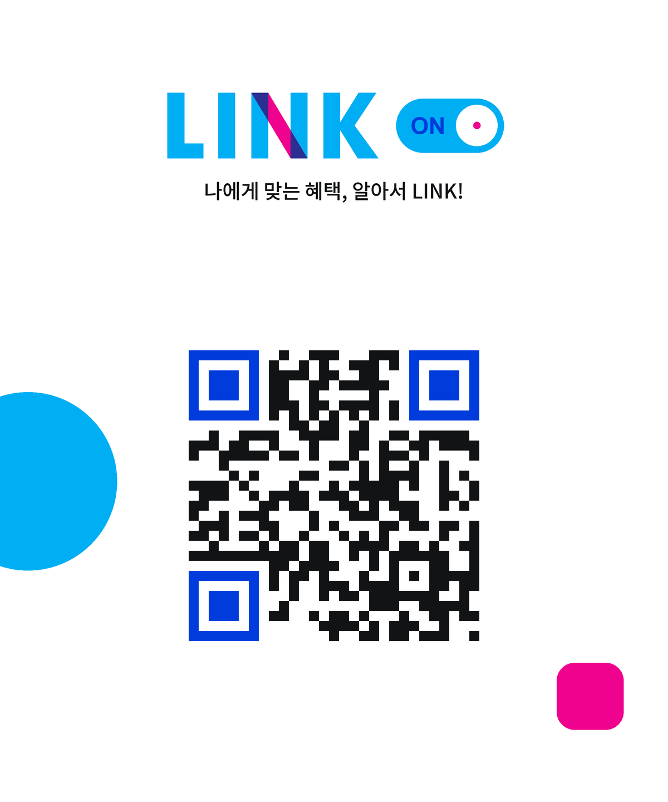

# LINK ON

**나에게 맞는 혜택, 알아서 LINK!**

**필요한 혜택을 알아서 챙겨주는 맞춤 LINK.** 고객에게 맞는 혜택은 고객별 한도 내에서 자동으로 연결하고, 나머지는 직접 고를 수 있도록 기획했습니다.

<a href="https://link-on.kro.kr/">
  
</a>

[웹에서 체험하기](https://link-on.kro.kr/) · [QR PNG 내려받기](docs/assets/LINK-ON-QR.png)

## 기획 배경

삼성카드 LINK는 카드 이용 패턴과 이용 지역에 맞는 혜택을 제공하는 서비스입니다. 2014년 4월 서비스를 시작했으며, 고객이 원하는 혜택을 결제 전에 LINK하면 조건에 맞는 결제에 혜택이 적용됩니다. ([삼성카드 연혁](https://www.samsungcard.com/company/introduction/history/UHPPCI0104M0.jsp), [LINK 이용안내](https://www.samsungcard.com/personal/services/link/UHPPBE0401M0.jsp?click=benefitmain_logout_link))

이 과정에서 고객은 혜택을 알고도 연결을 놓치거나, 앱을 확인하지 않아 혜택이 있는지 모를 수 있습니다. LINK ON은 **추천된 혜택이 실제 이용으로 이어지는 과정**의 번거로움을 줄이기 위한 제안입니다.

## 서비스 방식

고객이 처음 한 번 자동 LINK에 동의하고 관심 업종을 설정하면, 관심사와 결제 패턴을 바탕으로 적합한 혜택을 자동으로 연결합니다. 이후 평소처럼 결제하고, 실제 적용된 혜택을 확인합니다.

| 개념 | 설계 방향 |
| --- | --- |
| **O · 고객 맞춤** | 고객에게 필요한 혜택을 선별합니다. |
| **N · 자동 연결 혜택의 최대 개수** | 고객별 한도 내에서 연결합니다. 적합한 혜택이 없으면 한도를 채우지 않습니다. |
| **직접 선택** | 나머지 혜택은 고객이 직접 연결·해제할 수 있습니다. |

N은 고정된 숫자가 아닙니다. 실제 이용 효과와 할인·운영 비용을 확인하며 고객별 한도와 연결 범위를 조정하는 구조입니다. 고객 화면에는 **고객별 한도 내**로 안내합니다.

## 일부 혜택만 자동으로 연결하는 이유

고객이 직접 고른 혜택은 관심과 선호를 파악할 수 있는 데이터입니다. 모든 혜택을 자동으로 연결하면 이 선택 신호가 줄어들 수 있습니다. 또한 할인 없이도 구매했을 고객에게 할인이 적용되면, 추가 구매 효과 없이 비용만 늘어날 수 있습니다.

LINK ON은 자동 연결 범위를 제한하고 직접 선택을 함께 유지합니다. **고객의 선택은 남겨두면서, 놓치기 아까운 혜택을 먼저 챙겨주는 것**이 핵심입니다.

| 대상 | 기대하는 변화 |
| --- | --- |
| 고객 | 혜택을 찾고 연결하는 수고를 줄이면서 직접 선택할 권리도 유지합니다. |
| 삼성카드 | 고객의 관심 신호를 확보하면서 체감 혜택과 카드 이용 확대를 추구합니다. |
| 가맹점 | 할인 비용 대비 추가 구매와 재방문 효과를 확인하고 혜택 제공 범위를 조정합니다. |

## 검증할 내용

4주 시험 운영에서 기존 LINK 방식과 LINK ON을 비교하고, 다음 지표를 함께 확인하는 계획입니다.

| 지표 | 확인할 내용 |
| --- | --- |
| 자동 LINK 혜택의 실제 이용률 | 자동 연결된 혜택이 실제 할인 이용으로 이어지는지 |
| 고객의 체감 혜택 금액 | 고객이 실제로 받은 할인 금액이 늘어나는지 |
| 추가 결제 효과 | 기존 방식 대비 결제와 재이용이 늘어나는지 |
| 할인·운영 비용 | 추가 결제의 수익 기여가 비용을 상쇄하는지 |

단순한 연결 수보다 **고객이 받은 혜택과 추가 이용 효과**를 중심으로 판단합니다. 이 결과를 바탕으로 자동 연결 범위를 확대·유지·축소합니다. 위 내용은 검증 계획이며, 현재 웹 체험에서 측정한 운영 성과가 아닙니다.

## 체험 흐름

1. **LINK ON 시작하기**에서 동의하고 관심 업종을 선택합니다.
2. 자동 연결된 혜택의 이유와 이용 조건을 확인합니다.
3. **직접 고르는 혜택**에서 다른 혜택을 연결하거나 해제합니다.
4. **결제 체험하기**에서 가맹점과 금액을 고르고 시연 결제를 진행합니다.
5. 이용 결과에서 **할인 결과 확인하기**를 눌러 할인 적용 여부를 확인합니다.

실제 결제는 발생하지 않습니다. 폰 아래 **시연 설정**에서는 이용 패턴·날짜·중복 할인 조건도 바꿀 수 있습니다. PC에서 글자가 작으면 **원본 크기로 보기**를 사용하세요.

| 기능 | 동작 |
| --- | --- |
| 6개 업종·18개 혜택 | 업종별로 찾아 상세 조건 확인 |
| 자동 LINK | 맞춤 선정, 개별 제외, ON/OFF |
| 직접 LINK | 연결·해제·재연결을 행사별로 관리 |
| 이용 결과 | 확인 중·적용 완료·미적용 사유 표시 |
| 상태 유지 | 같은 브라우저에서 새로고침 후 복원 |

LINK ON을 꺼도 이미 연결된 혜택은 유지됩니다. 자동 연결에서 제외한 이번 행사는 다시 켜도 복구되지 않으며, 다른 혜택의 상태에는 영향을 주지 않습니다.

## 기획 자료

- [1Pager PDF](docs/reference/LINK_ON_1Pager.pdf) — 원본의 2쪽 구성
- [상세기획 PDF](docs/reference/LINK_ON_Detailed_Plan.pdf) — 발표자료 8장
- [서비스 정책과 시연 범위](docs/IMPLEMENTATION_GUIDE.md)
- [원본 출처·보관 정보](docs/reference/sources.json)

PDF는 보관 시점의 자료입니다. 이후 확장한 6개 업종·18개 혜택과 직접 해제 등의 차이는 구현 기준에 정리했습니다.

## 로컬 실행

React · TypeScript · Vite로 구현했습니다. Node.js 24 계열에서 다음과 같이 실행합니다.

```sh
npm ci
npm run dev
```

이 PC에서는 VS Code로 `C:\Users\KDA\LINK-ON`을 열거나 `start.cmd`를 실행할 수 있습니다. 이미 서버가 켜져 있으면 [로컬 화면](http://127.0.0.1:5173/)을 이용하세요.

수정은 **minseok → 검증·미리보기 → main 병합 → 운영 배포 확인** 순서로 진행합니다.

[실행·GitHub 업로드·배포 안내](docs/DEVELOPMENT.md) · [작업 규칙](AGENTS.md) · [변경 기록](CHANGELOG.md)

## 시연 범위

이 프로젝트는 개인 기획 발표용 프로토타입으로, 삼성카드·모니모의 공식 서비스가 아닙니다. 혜택 금액과 조건은 예시이며 실제 제휴를 뜻하지 않습니다. 회원 인증·실결제·금융 API·실제 추천 모델은 연결되어 있지 않습니다.

선택과 결제 예시는 브라우저에 저장됩니다. 시연 한도 기본값 2는 변경 가능한 가정이며, 실제 서비스의 한도를 확정한 값이 아닙니다.

검사는 `npm run build`, `npm run test:unit`, `npm test`로 실행합니다. 검사 결과와 확인 범위는 [배포 점검 기록](docs/VALIDATION_RELEASE.md)에 남깁니다. 외부 로고·폰트는 [자료 출처](THIRD_PARTY_NOTICES.md)를 확인하세요.
